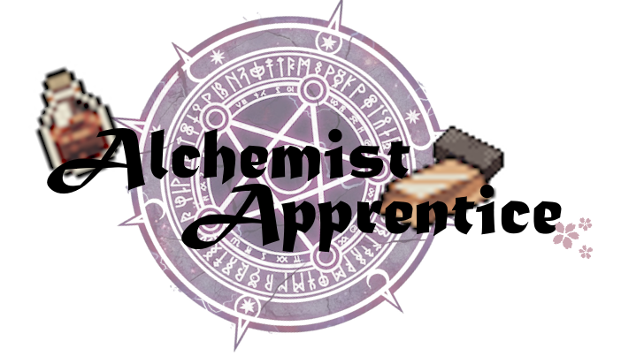

# AlchemistApprentice
**Try it on [itch(Not ready)](TODO)!**

Alchemist Apprentice is a puzzle game with only one core idea:

> If you have a matter A and a potion that can convert A into B, you get B.

You are given a set of initial items and your goal is to craft the target item.

Through the 6 chapters, more mechanism are introduced like combination, dark matters, potion brewers etc.

Clever readers may have noticed the game resembles a [Propositional Logic](https://en.wikipedia.org/wiki/Propositional_logic) [Axiomatic System](https://en.wikipedia.org/wiki/Axiomatic_system). Crafting something is similar to *proving* something!
